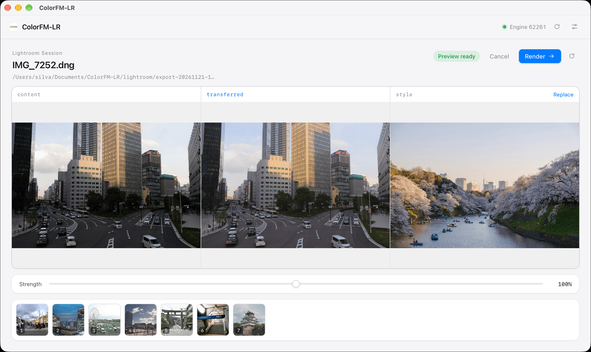
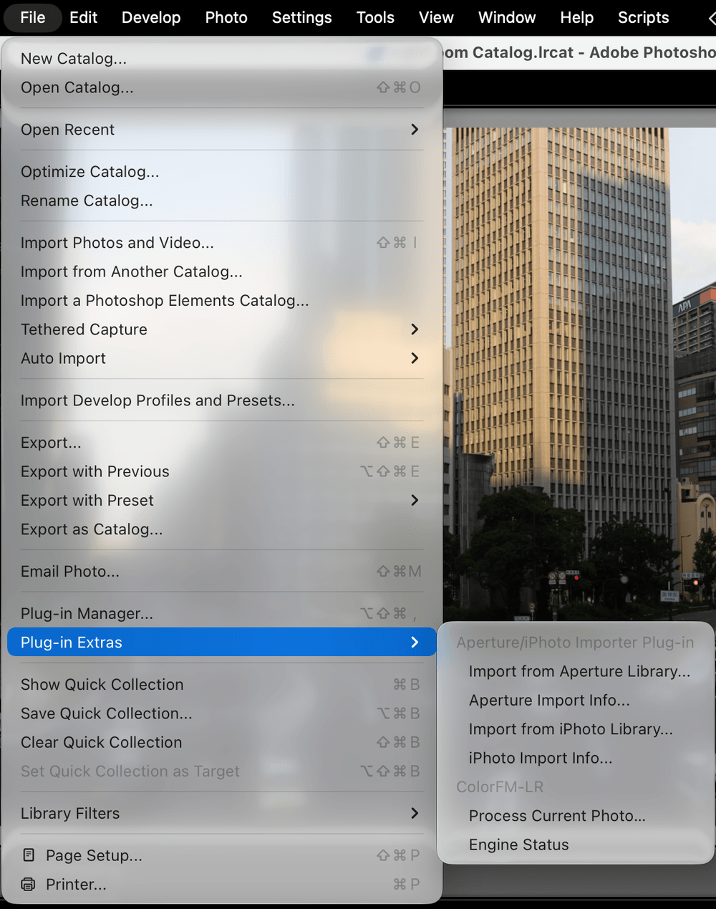
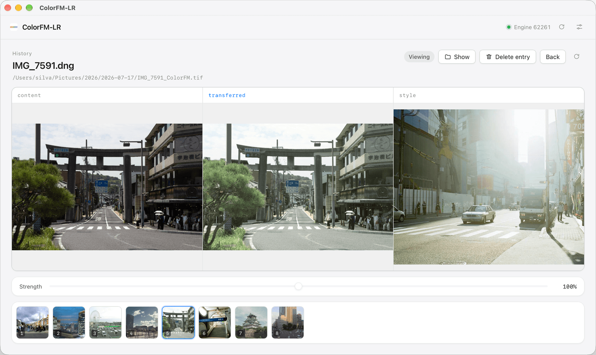

  

An AI Color Transfer plug-in for Lightroom, built on ColorFM

   <a href="README-build.md">Documents</a> · <a href="README-build-zh.md">文档</a>

  

  Pick a reference on the right; the result previews in the middle before anything is written back.

| In Lightroom | A finished result |
|:---:|:---:|
|  Plug-in Extras > ColorFM-LR: Process Current Photo, Engine Status"> |  |
| File → Plug-in Extras → ColorFM-LR | History keeps every finished render, each with its own delete |

Recommended workflow: set the exposure and camera corrections first → run the plug-in → continue with any further edits

建议流程：先调整标准曝光与相机校正 → 再用插件处理 → 最后做后续调整

